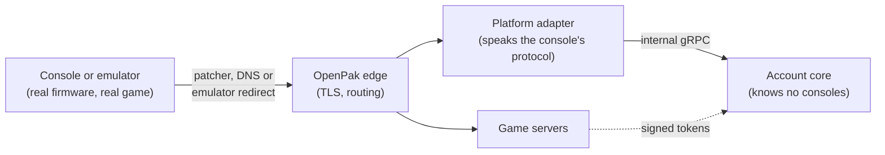
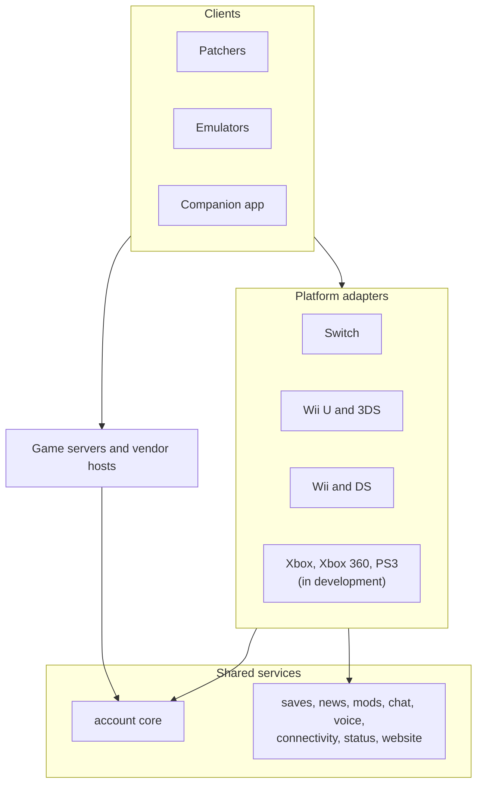

# How OpenPak fits together

This page explains what OpenPak is for and how its parts connect. The first half is for players.
The second half is a map for people who want to read or change the code.

OpenPak is in **public alpha**. Things will break, data may be reset, and there is no uptime
promise. Which platforms and games work today is in the
[status table on the organisation page](README.md#where-each-platform-stands) and, per game, at
[openpak.org/titles](https://openpak.org/titles). This page describes the design, not a promise
that every part is finished.

## What OpenPak is, and why

The official online services for many game consoles have shut down or are shutting down. When
that happens, friends lists, matchmaking, shops and cloud saves stop working, even though the
console and the games still run.

OpenPak runs replacements for those services:

- **Keep what you own.** Your console keeps its real firmware and your real games. Only the
  servers on the other end are replaced.
- **One network, many consoles.** One account, one friend list and one set of cloud saves cover
  every console and emulator you link.
- **Open and runnable by anyone.** OpenPak's own services are AGPL-3.0 (forks keep their upstream licences), one repository per service.
  Anyone can read it, fix it or run their own network.
- **Honest about limits.** OpenPak never ships games, firmware, keys or console data, and it
  does not patch game code on Switch, Wii U and 3DS apart from rare, reviewed exceptions. On Wii and DS the patchers redirect each
  game, because those games have no other way in.

## The one rule

> The console stays a real console. Only where it connects to changes.

A real console, or an OpenPak emulator running real firmware, behaves as it always did. It asks
for an account, a friend list or a match. OpenPak answers in the console's own protocol. Nothing
about the games has to change for that to work.

## How a console reaches OpenPak

A console does not know OpenPak exists, so something has to point it at OpenPak. There are three
ways, depending on the console:

- **A patcher** on the console (the Switch, Wii U, 3DS, Wii and DS patchers) changes where the
  console connects and installs a certificate so it trusts OpenPak's servers.
- **Console DNS** for consoles whose only network setting is a DNS server. A resolver sends the
  right names to OpenPak and everything else to the normal internet.
- **A firmware-first emulator** (Harbor, Quay and the others) has the same redirect built in. It
  boots the real firmware and goes online like a console would.

Which names get redirected comes from a **network profile** that the server generates from what
it actually serves. A **signed redirect ceiling** limits what a client will ever accept, so a
compromised server cannot make consoles redirect more than OpenPak signed off on. Details are in
the [signed redirect ceiling](https://docs.openpak.org/contributors/signed-ceiling/) page.

## One account for every network

Register once at [openpak.org](https://openpak.org), then link consoles and emulators to that
account. Each linked device is listed on your account page and can be revoked.

Behind that sits a simple split:

- **The account core** ([`account`](https://github.com/openpak/account)) holds accounts, sessions,
  two-step sign-in, the friend graph, presence, invitations and moderation. It holds no
  console protocol code, and a test fails the build if it imports Nintendo or Pretendo packages.
- **Platform adapters** speak one console family's native protocol on one side and the core's
  API on the other. They own that family's identifiers, such as friend codes and user ids.
- **A link** is the only thing the core knows about a console: a binding between an account and
  an identifier the adapter supplies.

This is why adding a console does not change the core, and why a friend you add on one console is
your friend everywhere. Every account gets an identity on every network automatically, and
friends, chat, presence and bans are network-wide. See [friends and chat](https://docs.openpak.org/players/friends/)
and [your account](https://docs.openpak.org/players/account/).

Game servers never keep their own accounts. They trust tokens issued for OpenPak identities, so
a player is the same person on every server.

## Layers and where each repository fits

Every service is its own repository with its own README, tests, image and release. Browse by
topic with the filters on the [organisation page](README.md#finding-your-way-around).

### Shared services

| Repository | What it does |
| --- | --- |
| [`account`](https://github.com/openpak/account) | The account core. Its API contracts live in [`account-api`](https://github.com/openpak/account-api), a Go library used by services that talk to the core. |
| [`website`](https://github.com/openpak/website) | openpak.org: sign-up, the account portal, the title catalogue, the network profile and the mobile API. |
| [`chat`](https://github.com/openpak/chat) | One message store for the website, the app and consoles. |
| [`voice`](https://github.com/openpak/voice) | Voice sessions. |
| [`parental`](https://github.com/openpak/parental) | The parental-controls core that console adapters build on. |
| [`connectivity`](https://github.com/openpak/connectivity) | Relay and TURN credentials for multiplayer. |
| [`nn-nncs`](https://github.com/openpak/nn-nncs) | NAT checks for Wii U, 3DS and Switch. |
| [`nn-sssl-dns`](https://github.com/openpak/nn-sssl-dns) | Console DNS. |
| [`status`](https://github.com/openpak/status) | The [status page](https://status.openpak.org). |

### Per-platform adapters

| Platform | Repositories |
| --- | --- |
| Switch | [`nx-baas`](https://github.com/openpak/nx-baas) (accounts, console link, friends), [`nx-shop`](https://github.com/openpak/nx-shop), [`nx-penne`](https://github.com/openpak/nx-penne), [`nx-pctl`](https://github.com/openpak/nx-pctl), [`nx-bcat`](https://github.com/openpak/nx-bcat), shared library [`nx-common`](https://github.com/openpak/nx-common) |
| Wii U and 3DS | [`nn-account`](https://github.com/openpak/nn-account), [`nn-friends`](https://github.com/openpak/nn-friends), [`nn-boss`](https://github.com/openpak/nn-boss), [`nn-juxtaposition`](https://github.com/openpak/nn-juxtaposition), [`nn-soap`](https://github.com/openpak/nn-soap), [`nn-sssl`](https://github.com/openpak/nn-sssl) |
| Wii and DS | One repository per Wi-Fi Connection service, for example [`wfc-nas`](https://github.com/openpak/wfc-nas), [`wfc-gpcm`](https://github.com/openpak/wfc-gpcm), [`wfc-qr2`](https://github.com/openpak/wfc-qr2) and [`wfc-natneg`](https://github.com/openpak/wfc-natneg), with [`wfc-common`](https://github.com/openpak/wfc-common) |
| PlayStation 3 (in development) | [`np-account`](https://github.com/openpak/np-account), [`np-community`](https://github.com/openpak/np-community), [`np-trophy`](https://github.com/openpak/np-trophy), [`np-common`](https://github.com/openpak/np-common) |
| Xbox 360 (in development) | One repository per service, for example [`x360-kdc`](https://github.com/openpak/x360-kdc), [`x360-gateway`](https://github.com/openpak/x360-gateway) and [`x360-xuacs`](https://github.com/openpak/x360-xuacs), with [`x360-common`](https://github.com/openpak/x360-common) |
| Xbox (in development) | The `xb-*` repositories, for example [`xb-gateway`](https://github.com/openpak/xb-gateway) and [`xb-account`](https://github.com/openpak/xb-account), with [`xb-common`](https://github.com/openpak/xb-common) |

An adapter replies in the console's own words, and consoles are strict about that. Adapters
therefore test their replies against recorded reply shapes.

### Game servers and vendor hosts

Game servers run the online part of specific games. Most are one shared host per protocol
family, with a small package per game:

- NEX, the matchmaking protocol of many Nintendo titles: [`nex`](https://github.com/openpak/nex)
  (Wii U, 3DS and Switch) and [`switch-nex`](https://github.com/openpak/switch-nex) (the Switch-era lineage).
- NPLN, used by many Switch titles: [`npln`](https://github.com/openpak/npln).
- Third-party backends that several games share: [`photon`](https://github.com/openpak/photon),
  [`demonware`](https://github.com/openpak/demonware), [`eos`](https://github.com/openpak/eos),
  [`playfab`](https://github.com/openpak/playfab), [`klei`](https://github.com/openpak/klei),
  [`t17`](https://github.com/openpak/t17) and [`ugs`](https://github.com/openpak/ugs).
- Single-game servers, for example [`outbound`](https://github.com/openpak/outbound) and
  [`among-us`](https://github.com/openpak/among-us).

### Clients: patchers and emulators

| Kind | Repositories |
| --- | --- |
| Patchers | [`switch-patcher`](https://github.com/openpak/switch-patcher), [`wiiu-patcher`](https://github.com/openpak/wiiu-patcher), [`3ds-patcher`](https://github.com/openpak/3ds-patcher), [`wii-patcher`](https://github.com/openpak/wii-patcher), [`ds-patcher`](https://github.com/openpak/ds-patcher). Xbox, Xbox 360 and PS3 patchers exist as repositories but are not available yet. |
| Emulators | [`harbor`](https://github.com/openpak/harbor) (Switch), [`quay`](https://github.com/openpak/quay) and [`marina`](https://github.com/openpak/marina) (early), [`azahar`](https://github.com/openpak/azahar) and [`melonds`](https://github.com/openpak/melonds) (no tested build yet), and experimental [`wharf`](https://github.com/openpak/wharf), [`berth`](https://github.com/openpak/berth) and [`pier`](https://github.com/openpak/pier). Emulator guides are in the [docs](https://docs.openpak.org/players/setup/emulators/). |
| Shared client code | [`openpak-client`](https://github.com/openpak/openpak-client), shared by the OpenPak emulators; Qt-based ones also use its menu, sign-in and network profile code. |
| Companion app | [`app`](https://github.com/openpak/app) for Android (no iOS build is released yet): account, friends, presence, invitations and saves. |

## Saves, news, shops, mods and status

These are separate services so that every platform can use them:

- **Cloud saves** ([`saves`](https://github.com/openpak/saves)): an index of your saves under your
  account, a small allowance on OpenPak, and the option to keep the files in storage you own.
  Support is partial during the alpha. See [cloud saves](https://docs.openpak.org/players/cloud-saves/).
- **News** ([`news`](https://github.com/openpak/news)): articles targeted by platform, game, region
  and language.
- **Shops** ([`nx-shop`](https://github.com/openpak/nx-shop) for the Switch eShop front, and
  [`hbstore-tools`](https://github.com/openpak/hbstore-tools), the packaging tools behind the homebrew store).
- **Mods** ([`mods`](https://github.com/openpak/mods)): a catalogue of cosmetic and local mods that
  records the source and licence of every package and hosts no game assets.
- **Status** ([`status`](https://github.com/openpak/status)): a public status page, run apart from
  the machines it watches.

## Federation and your own network

Two different things are possible, and the
[self-hosting docs](https://docs.openpak.org/self-hosting/) explain both.

- **Your own network.** The software is AGPL-3.0, so anyone may run a separate network with its
  own accounts. Clients are built to trust openpak.org, so a separate network needs its own
  signing key, certificate authority and client builds. A complete path for that is not ready
  yet. Start with [running your own network](https://docs.openpak.org/self-hosting/) and
  [deploying](https://docs.openpak.org/self-hosting/deploy/).
- **A federation node.** A node is a relay for the main network in one region, so game traffic
  takes a shorter path. Accounts, friends and matchmaking stay on openpak.org, and a node holds
  none of them. Every node is approved by a person at OpenPak, and each server on a node has its
  own key, and neither the node key nor a server key can read accounts, friends or links. The
  [node setup package](https://github.com/openpak/node) is the code a node runs. The docs say
  the compose setup is not published yet. Read
  [how federation works](https://docs.openpak.org/self-hosting/federation/) and
  [becoming a federation node](https://docs.openpak.org/self-hosting/become-a-node/).

Only OpenPak and its approved nodes may use the OpenPak name and logo.

## Where to start

**Players**

1. [What OpenPak is and what works today](https://docs.openpak.org/players/)
2. [Before you start](https://docs.openpak.org/players/before-you-start/)
3. [Create your account](https://docs.openpak.org/players/account/)
4. [Set up your console or emulator](https://docs.openpak.org/players/setup/)
5. Stuck? [Troubleshooting](https://docs.openpak.org/players/troubleshooting/) and the
   [FAQ](https://docs.openpak.org/players/faq/), then the
   [Discord](https://discord.gg/nMhjnsB6F6).

**Contributors**

1. [Architecture](https://docs.openpak.org/contributors/architecture/), the longer version of this page
2. [How the repositories are organised](https://docs.openpak.org/contributors/repositories/)
3. [Building and running](https://docs.openpak.org/contributors/building/) and
   [conventions](https://docs.openpak.org/contributors/conventions/)
4. The [clean-room rule](https://docs.openpak.org/contributors/clean-room/), before you touch
   anything built from outside facts
5. [Reporting bugs](https://docs.openpak.org/contributors/reporting/) and
   [CONTRIBUTING](https://github.com/openpak/.github/blob/main/CONTRIBUTING.md)

**Self-hosters**

1. [Running your own network](https://docs.openpak.org/self-hosting/)
2. [Deploying](https://docs.openpak.org/self-hosting/deploy/)
3. [Becoming a federation node](https://docs.openpak.org/self-hosting/become-a-node/)

## How mature is it

Public alpha. Switch is the furthest along, Wii U, 3DS, Wii and DS are in beta, and Xbox,
Xbox 360 and PlayStation 3 are in development. PSP, PS2 and Vita are planned. A repository
existing for a platform does not mean the platform works. Check the
[status table](README.md#where-each-platform-stands), the
[feature list](https://openpak.org/features) and [openpak.org/titles](https://openpak.org/titles)
before you set anything up, and keep your own copies of any saves you care about.
